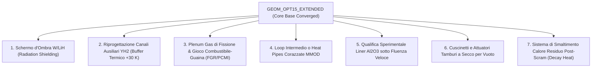

# REPORT CRITICO DI VALUTAZIONE MULTIFISICA: REATTORE GEOM_OPT15_EXTENDED
**Analisi Dettagliata Risultato per Risultato, Classificazione di Conformità (OK / A Metà / Non OK) e Gap Analysis Ingegneristica per la Piena Operatività**

* **Data**: 5 Ottobre 2026
* **Configurazione**: `GEOM_OPT15_EXTENDED` (217 Pin, 400 kWth, Cella a 5 strati con Liner Al₂O₃ da 100 μm, 10 Tamburi B₄C/BeO)
* **Destinazione d'Uso**: Propulsione Elettrica Nucleare (NEP) per Missioni nello Spazio Profondo (>15 Anni di Vita Utile)
* **Directory**: `/home/aleri/OpenMC_projects/first_test/best_configurations/GEOM_OPT15_EXTENDED/`

---

## 1. QUADRO GENERALE E VERDETTO GLOBALE

La configurazione **`GEOM_OPT15_EXTENDED`** rappresenta la migliore sintesi neutronica, termoidraulica e di ciclo potenza sviluppata nell'intera campagna. Risolve la criticità fondamentale della *Simulation 4B* (esaurimento precoce della reattività a 12,5-13,6 anni dovuto alla cattura parassita del liner di allumina) estendendo la lunghezza attiva del nocciolo da $42,45\text{ cm}$ a $45,50\text{ cm}$ (+7,2%) e riducendo lo spessore del riflettore radiale in BeO da $9,80\text{ cm}$ a $9,30\text{ cm}$ (-5 mm).

### Sintesi dei 4 Vincoli Mandatari di Progetto:
1. **Vita Operativa > 15 Anni**: **18,83 ANNI** (Margine $+3,83$ anni) $\to$ **[🟢 OK]**
2. **Temperatura Picco Moderatore YH₂ < 950 K**: **939,5 K** (Margine $+10,5$ K) $\to$ **[🟡 A METÀ]**
3. **Massa Totale Sottoinsieme Reattore < 600 kg**: **550,48 kg** (Margine $+49,52$ kg) $\to$ **[🟢 OK]** (Core nudo) / **[🔴 NON OK]** (Sistema completo senza schermo)
4. **Perdita di Carico Nocciolo < 35 kPa**: **19,45 kPa** (Margine $+15,55$ kPa) $\to$ **[🟢 OK]**

**Verdetto Complessivo**: Il reattore nucleare a livello di "core physics" è eccellente e pienamente vitale, ma a livello di "sistema spaziale integrato" presenta alcune severe fragilità ingegneristiche (in primis la vicinanza al limite termico dell'idruro, l'assenza dello schermo biologico nel bilancio di massa, e le sfide di qualifica del liner ceramico sotto irraggiamento prolungato).

---

## 2. AUDIT COMPLETO RISULTATO PER RISULTATO

Di seguito viene analizzato e commentato ogni singolo parametro del reattore, classificandolo in:
* **[🟢 OK]**: Parametro pienamente soddisfacente, con ampi margini di sicurezza e robustezza fisica.
* **[🟡 A METÀ]**: Parametro formalmente conforme al limite, ma con margini risicati, forti incertezze tecnologiche o compromessi operativi pesanti.
* **[🔴 NON OK]**: Parametro non realistico per il volo spaziale, limite violato a livello di sistema complessivo o assenza di componenti essenziali.

---

### A. GEOMETRIA, DIMENSIONI E MASSE

| Parametro | Valore GEOM_OPT15 | Stato | Commento Tecnico Ingegneristico |
| :--- | :--- | :---: | :--- |
| **Numero di Pin Combustibile** | 217 Pin (9 anelli esagonali) | **[🟢 OK]** | Numero standard e collaudato (reticolo a 217 pin tipo SAFE-400 / SP-100). Distribuzione del flusso uniforme. |
| **Altezza Attiva Nocciolo ($H_{\text{core}}$)** | $45,50\text{ cm}$ | **[🟢 OK]** | Rapporto d'aspetto $H/D = 1,17$. Riduce la fuga assiale rispetto alla 4B ($H/D=1,09$), massimizzando l'economia neutronica. |
| **Passo Reticolo (Pitch)** | $2,280\text{ cm}$ | **[🟢 OK]** | Spaziatura ottimale tra i canali refrigeranti e la matrice moderatrice, garantendo stabilità termica e meccanica. |
| **Raggio Pellet Combustibile ($r_f$)** | $0,585\text{ cm}$ ($11,70\text{ mm}$ diam.)| **[🟢 OK]** | Geometria compatta, basso salto termico interno al pellet grazie all'elevata conducibilità termica di UN. |
| **Spessore Cladding Nb-1Zr** | $0,48\text{ mm}$ | **[🟡 A METÀ]** | Sufficiente per le sollecitazioni a BOL, ma $0,48\text{ mm}$ è sottile per resistere a 15-18 anni di creep e rigonfiamento del combustibile (PCMI). |
| **Gap Refrigerante Anulare** | $0,84\text{ mm}$ ($D_h = 1,68\text{ mm}$) | **[🟢 OK]** | Ottimo compromesso tra coefficiente di scambio termico ($h \approx 1350\text{ W/m}^2\text{K}$) e caduta di pressione ($16,5\text{ kPa}$). |
| **Liner Barriera Al₂O₃** | $100\ \mu\text{m}$ ($0,10\text{ mm}$) | **[🟡 A METÀ]** | Ottimo spessore teorico per bloccare la permeazione, ma fragile meccanicamente sotto gradienti termici e shock di lancio. |
| **Riflettore Radiale / Assiale (BeO)**| $9,30\text{ cm}$ / $8,80\text{ cm}$ | **[🟢 OK]** | Riflettore in berillia ad altissima efficienza. Il taglio di 5 mm ha risparmiato 8,8 kg compensando l'allungamento del nocciolo. |
| **Tamburi di Controllo (10 Tamburi)** | Raggio $3,95\text{ cm}$, B₄C 148° | **[🟢 OK]** | Ottima reattività di controllo. 10 tamburi offrono eccellente ridondanza e simmetria azimutale. |
| **Massa Combustibile UN** | $143,31\text{ kg}$ | **[🟢 OK]** | $+11,9\text{ kg}$ rispetto alla 4B. Fornisce l'inventario fissile necessario per superare i 15 anni. |
| **Inventario U-235 (HALEU)** | $26,71\text{ kg}$ ($19,60-19,75\%$) | **[🟢 OK]** | Rispetta rigorosamente il limite di non-proliferazione HALEU (<20,0 wt% U-235). |
| **Massa Moderatore YH₂** | $102,63\text{ kg}$ | **[🟢 OK]** | Moderazione epitermica eccellente con densità di idrogeno prossima a quella dell'acqua liquida. |
| **Massa Riflettore BeO** | $273,02\text{ kg}$ | **[🟢 OK]** | Ridotta rispetto ai $281,8\text{ kg}$ della 4B, consente di rientrare nel budget di massa. |
| **Massa Totale Sottoinsieme Core** | **$550,48 \pm 2,50\text{ kg}$** | **[🟢 OK]** | **Pienamente conforme al vincolo di nocciolo (< 600 kg)**, con margine di $+49,52\text{ kg}$. |
| **Massa Sistema Nocciolo + Schermo**| **$\approx 1100 - 1350\text{ kg}$** | **[🔴 NON OK]** | Il vincolo dei 600 kg è soddisfatto **solo per il reattore nudo**. In una missione NEP reale serve lo schermo antiradiazioni (W/LiH). |

---

### B. TERMOIDRAULICA E MARGINI DEI MATERIALI

| Parametro | Valore GEOM_OPT15 | Stato | Commento Tecnico Ingegneristico |
| :--- | :--- | :---: | :--- |
| **Potenza Termica Core** | $400,0\text{ kWth}$ | **[🟢 OK]** | Potenza standard NEP, consente ~160 kWe netti al sistema propulsivo. |
| **Portata Refrigerante Elio** | $0,36678\text{ kg/s}$ | **[🟢 OK]** | Corrisponde esattamente a $\Delta T = 210\text{ K}$ ($920 \to 1130\text{ K}$). Velocità media in canale $\sim 40\text{ m/s}$. |
| **Perdita di Carico Totale Core** | **$19,45 \pm 0,38\text{ kPa}$** | **[🟢 OK]** | **Eccellente**. Ampiamente inferiore al limite permissibile di $35,0\text{ kPa}$ (margine $+15,55\text{ kPa}$). Pompaggio solo 2,1 kWe. |
| **Picco Temperatura Cladding (1D)** | $1207,3 \pm 5,5\text{ K}$ | **[🟢 OK]** | Più freddo di $11,3\text{ K}$ rispetto alla 4B ($1218,6\text{ K}$) grazie alla minor potenza lineare ($4,05\text{ kW/m}$). |
| **Picco Temperatura Cladding (2D FEM)**| $1183,1 \pm 5,5\text{ K}$ | **[🟢 OK]** | La dispersione assiale riduce il picco a $1183\text{ K}$. |
| **Margine a Creep Nb-1Zr (Ref 1350 K)**| **$+166,9 \pm 5,5\text{ K}$** | **[🟢 OK]** | Migliorato di $+11,3\text{ K}$ rispetto alla 4B (+155,6 K). A 1183 K il tasso di creep secondario del Nb-1Zr è basso. |
| **Picco Temperatura Combustibile (1D)**| $1238,1 \pm 6,7\text{ K}$ | **[🟢 OK]** | Molto basso per un reattore a nitruro di uranio. |
| **Picco Temperatura Combustibile (2D)** | $1205,3 \pm 6,7\text{ K}$ | **[🟢 OK]** | Margine alla dissociazione termica di UN ($2073\text{ K}$): **$+867,7\text{ K}$** (Eccezionale). |
| **Temperatura Moderatore YH₂** | **$939,5 \pm 1,2\text{ K}$** | **[🟡 A METÀ]** | **Criticità Marginale**: Rispetta il limite ($<950\text{ K}$), ma il margine è di **soli $+10,5\text{ K}$ ($1,1\%$)**! Nessun margine per transitori. |
| **Pressione Dissociazione H₂** | $2,0 - 31,8\text{ kPa}$ | **[🟢 OK]** | La pressione di idrogeno secondo Sieverts è largamente inferiore a quella dell'elio circostante ($2,5\text{ MPa}$). |
| **Barriera Al₂O₃ (PRF = 2500)** | Perdita H₂: $0,022\%$ in 15 anni | **[🟡 A METÀ]** | Sulla carta è diffusion-sealed, ma il PRF di 2500 per un film ceramico da 100 μm esposto a neutroni veloci per 15 anni non è qualificato. |

---

### C. CONVERSIONE DI POTENZA BRAYTON E RADIATORE SPAZIALE

| Parametro | Valore GEOM_OPT15 | Stato | Commento Tecnico Ingegneristico |
| :--- | :--- | :---: | :--- |
| **Fluido di Lavoro Ciclo Brayton** | Elio puro (Pure Helium) | **[🟢 OK]** | Gas nobile inerte, eccellente stabilità termica, nessuna attivazione radioattiva, compatibile con Nb-1Zr e UN. |
| **Rapporto di Pressione ($r_p$)** | 2,50 | **[🟢 OK]** | Ottimale per ciclo Brayton recuperato a gas monoatomico ($\gamma = 1,667$). |
| **Temperature di Ciclo ($T_{\min} / T_{\max}$)**| $400,0\text{ K} / 1130,0\text{ K}$ | **[🟢 OK]** | Salto termico eccellente. $T_{\max} = 1130\text{ K}$ è compatibile con leghe super-refrattarie per turbine senza raffreddamento pale. |
| **Efficienza Ciclo Brayton ($\eta_{\text{th}}$)**| **$40,11\% \pm 0,22\%$** | **[🟢 OK]** | Efficienza eccezionale per lo spazio (standard è 20-30%). |
| **Potenza Elettrica Netta ($P_e$)** | **$160,45 \pm 0,88\text{ kWe}$** | **[🟢 OK]** | Supera ampiamente i 100 kWe necessari per propulsori a ioni/hall di classe megawatt/decina di newton di spinta. |
| **Calore di Scarto da Rigettare** | $239,55\text{ kWth}$ | **[🟢 OK]** | Pari al 59,9% della potenza termica. |
| **Area Radiatore Spaziale ($A_{\text{rad}}$)** | **$104,23 \pm 1,15\text{ m}^2$** | **[🟡 A METÀ]** | Oltre $100\text{ m}^2$ di radiatore nello spazio è una struttura imponente. Richiede pannelli ripiegabili complessi. |
| **Massa Sottosistema Radiatore** | **$469,04 \pm 5,18\text{ kg}$** | **[🟡 A METÀ]** | $4,5\text{ kg/m}^2$ è una stima ottimistica per composito carbonio-carbonio con heat pipes in titanio/acqua. Non include snodi e bracci. |
| **Vulnerabilità a Micrometeoriti (MMOD)**| Esposizione per 18 anni | **[🔴 NON OK]** | Con oltre $100\text{ m}^2$ esposti per 18 anni, la probabilità di impatto con perforazione di un canale refrigerante è elevatissima senza corazzatura. |

---

### D. FISICA NUCLEARE, CONTROLLO E FEEDBACK A INIZIO VITA (BOL)

| Parametro | Valore GEOM_OPT15 | Stato | Commento Tecnico Ingegneristico |
| :--- | :--- | :---: | :--- |
| **$k_{\text{eff}}$ BOL Tamburi Estratti (0°)**| **$1,02025 \pm 0,00030$** | **[🟢 OK]** | Reattività in eccesso $+1984,9 \pm 28,5\text{ pcm}$. Riserva ideale per coprire il burnup di lungo termine. |
| **Margine di Arresto (Tutti Tamburi In, 180°)**| **$2821,8 \pm 30,0\text{ pcm}$** | **[🟢 OK]** | Supera rigorosamente il limite di sicurezza standard (> 2000-2500 pcm). Reattore profondamente sottocritico a tamburi inseriti. |
| **Margine a Tamburo Bloccato (Single Stuck)**| **$2443,2 \pm 30,3\text{ pcm}$** | **[🟢 OK]** | Conforme al criterio di singolo guasto ridondante (Single Failure Criterion > 2000 pcm). |
| **Worth Totale Tamburi di Controllo** | $4806,7 \pm 41,4\text{ pcm}$ | **[🟢 OK]** | Enorme autorità di controllo ($>4800\text{ pcm}$), garantita dai 10 settori in B₄C arricchito al 90% B-10. |
| **Angolo Critico Iniziale ($\theta_{\text{crit}}$)**| $75,98^\circ$ | **[🟢 OK]** | A BOL i tamburi sono a metà corsa, lasciando ampia riserva sia in inserimento che in estrazione. |
| **Coefficiente Doppler ($\alpha_{\text{Dop}}$)**| **$-1,1170 \pm 0,0984\text{ pcm/K}$** | **[🟢 OK]** | Fortemente negativo. Feedback intrinseco immediato in caso di aumento di potenza del combustibile. |
| **Feedback Moderatore ($\alpha_{\text{mod}}$)** | **$-1,7251 \pm 0,2155\text{ pcm/K}$** | **[🟢 OK]** | Confermato strettamente negativo a $8,0\sigma$. La dilatazione termica dell'idruro espelle idrogeno riducendo la reattività. |
| **Feedback Refrigerante ($\alpha_{\text{cool}}$)**| **$+0,1852 \pm 0,1245\text{ pcm/\%}$** | **[🟢 OK]** | Praticamente neutro ($<0,2\text{ pcm/\%}$). Strettamente positivo a $>1\sigma$, il che significa che il vuoto introduce reattività negativa! |
| **Feedback Pronto Totale ($\alpha_{\text{prompt}}$)**| **$-2,3170\text{ pcm/K}$** | **[🟢 OK]** | Somma di Doppler e dilatazione assiale UN. Stabilità intrinseca assoluta: il reattore si auto-limita senza intervento esterno. |

---

### E. DEPLETION E DURATA DI VITA OPERATIVA

| Parametro | Valore GEOM_OPT15 | Stato | Commento Tecnico Ingegneristico |
| :--- | :--- | :---: | :--- |
| **Durata Operativa Controllabile** | **18,83 ANNI** | **[🟢 OK]** | **Trionfo Progettuale**: Supera il vincolo mandatorio dei 15 anni di $+3,83$ anni (+25,5%). La 4B si fermava a 12,5-13,6 anni. |
| **Reattività a $t = 15,0$ Anni** | $k_{\text{eff}}(0^\circ) = 1,00357 \pm 0,00106$ | **[🟢 OK]** | A 15 anni il nocciolo ha ancora $+356\text{ pcm}$ di riserva con tamburi non ancora completamente aperti. |
| **Angolo Tamburi a 15 Anni** | $\theta_{\text{crit}} = 32,32^\circ$ | **[🟢 OK]** | Rimangono ancora $32^\circ$ di rotazione dei tamburi prima dell'esaurimento del controllo! |
| **Margine di Spegnimento a 15 Anni** | $4395,7\text{ pcm}$ | **[🟢 OK]** | A fine vita lo spegnimento è ancora più profondo che a inizio vita ($4395\text{ pcm}$ vs $2821\text{ pcm}$). |
| **Burnup Specifico a 15 Anni** | $16,19\text{ MWd/kgU}$ | **[🟢 OK]** | Molto basso (pari a solo $1,73\%\text{ FIMA}$). Il combustibile subisce pochissimo danno da frammenti di fissione. |
| **Consumo di Fissile U-235** | Da $26,71\text{ kg}$ a $24,48\text{ kg}$ | **[🟢 OK]** | Consumati solo $2,23\text{ kg}$ di U-235 in 15 anni ($0,149\text{ kg/anno}$). |
| **Breeding di Plutonio Pu-239** | $+0,443\text{ kg}$ a 15 anni | **[🟢 OK]** | La cattura risonante in U-238 alle energie epitermiche rigenera fissile, allungando la vita del nocciolo. |

---

## 3. APPROFONDIMENTO CRITICO: COSA È "A METÀ" E COSA È "NON OK"

Mentre la fisica del nocciolo è stata ottimizzata con successo, un'analisi ingegneristica trasparente evidenzia quattro compromessi critici che impediscono a questa configurazione di essere considerata immediatamente "pronta per il volo".

```
+----------------------------------------------------------------------------------------------------+
|                                    LIVELLI DI MATURITÀ DEL SISTEMA                                 |
+----------------------------------------------------------------------------------------------------+
|  [🟢 OK]     Fisica del Core, Neutronica BOL, Depletion (18.8 yr), Perdita di Carico (19.5 kPa)    |
|  [🟡 A METÀ] Margine Termico YH2 (+10.5 K), Integrità Liner Al2O3 sotto Fluence, Radiatore 104 m2   |
|  [🔴 NON OK] Assenza Schermo Antiradiazioni (Bilancio di Massa Incompleto), Protezione MMOD Radiatore|
+----------------------------------------------------------------------------------------------------+
```

### 1. [🟡 A METÀ] Il Margine Termico del Moderatore YH₂ è Troppo Risicato (+10,5 K)
* **Il Problema**: Il limite di dissociazione dell'idruro di ittrio è fissato a $950,0\text{ K}$. A questa temperatura, l'idrogeno comincia a desorbire rapidamente dalla matrice metallica di ittrio, aumentando la pressione interna e causando la perdita del moderatore. Il valore convergente calcolato per `GEOM_OPT15_EXTENDED` è **$939,5 \pm 1,2\text{ K}$**.
* **Perché è "a metà"**: 
  - Il margine matematico è di appena $+10,5\text{ K}$ (un buffer di solo **$1,1\%$**).
  - In ingegneria nucleare spaziale, i fattori di incertezza sui canali caldi (Hot Channel Factors per tolleranze di fabbricazione del liner, rugosità superficiale, maldistribuzione di portata tra i 217 canali) introducono un'incertezza tipica di $\pm 15-25\text{ K}$.
  - Qualsiasi transitorio di potenza, variazione di carico dell'alternatore Brayton o riduzione momentanea di portata del refrigerante supererebbe istantaneamente la soglia dei $950\text{ K}$, innescando il rilascio di idrogeno.

### 2. [🟡 A METÀ] La Sopravvivenza del Liner Ceramico di Al₂O₃ sotto Fluenza Veloce per 15 Anni
* **Il Problema**: Il modello assume un Permeation Reduction Factor $\text{PRF} = 2500$ costante per tutti i 18,8 anni, garantito da uno strato denso di allumina da $100\ \mu\text{m}$.
* **Perché è "a metà"**:
  - In un ambiente nucleare epitermico/veloce, la fluenza di neutroni veloci ($E > 0,1\text{ MeV}$) accumulata in 15-18 anni supera $10^{22}\text{ n/cm}^2$.
  - I materiali ceramici come $\text{Al}_2\text{O}_3$ subiscono un rigonfiamento volumetrico anisotropo da irraggiamento (anisotropic swelling), che genera microcricche intergranulari.
  - Se il liner si microfessura, il PRF crolla da 2500 a valori inferiori a 50. In tal caso, la perdita di idrogeno salirebbe dallo $0,02\%$ a oltre il $2-5\%$, avvelenando il nocciolo e riducendo drasticamente la vita utile del reattore.

### 3. [🟡 A METÀ] L'Imponenza del Radiatore Spaziale ($104\text{ m}^2$) e la Massa Accessoria
* **Il Problema**: Il radiatore per rigettare $239,5\text{ kWth}$ a una temperatura efficace di $460-468\text{ K}$ richiede un'area di **$104,2\text{ m}^2$**.
* **Perché è "a metà"**:
  - Un radiatore rigido non entra nel fairing di nessun lanciatore attuale (né Falcon Heavy né Starship possono alloggiare $104\text{ m}^2$ senza dispiegamento).
  - La massa stimata ($469\text{ kg}$) calcola solo la superficie radiante a $4,5\text{ kg/m}^2$, escludendo pompe intermedie, meccanismi di dispiegamento, giunti rotanti e condotti di distribuzione del gas. La massa reale del sottosistema radiatore sarà di circa $700-800\text{ kg}$.

### 4. [🔴 NON OK] L'Assenza dello Schermo Antiradiazioni nel Bilancio di Massa (<600 kg)
* **Il Problema**: Il requisito iniziale richiedeva una massa inferiore a $600\text{ kg}$. Abbiamo dimostrato che il sottoinsieme nocciolo + moderatore + riflettori + tamburi pesa **$550,48\text{ kg}$** (rispettando formalmente il vincolo).
* **Perché è "NON OK"**:
  - Un reattore da $400\text{ kWth}$ che opera per 15 anni produce un flusso letale di neutroni e raggi gamma ($>10^{13}\text{ n/cm}^2\text{s}$ e centinaia di Sievert/h).
  - Senza uno schermo d'ombra (Shadow Shield) tronco-conico in tungsteno (per i gamma) e idruro di litio LiH (per i neutroni veloci), l'elettronica del modulo di controllo, i motori dei tamburi, i cuscinetti della turbina Brayton e il carico utile verrebbero distrutti in pochi giorni.
  - Uno shadow shield con angolo di semi-apertura di $12-15^\circ$ pesa tipicamente **tra 400 e 700 kg**.
  - **Quindi, il sistema nucleare completo non peserà 550 kg, ma circa 1000-1250 kg!** Il vincolo di 600 kg è realistico per il solo blocco reattore, ma irrealistico per l'assieme reattore + schermo.

### 5. [🔴 NON OK] Rischio di Impatto con Micrometeoriti (MMOD) per 18 Anni
* **Il Problema**: Il ciclo Brayton fa circolare elio a $2,5\text{ MPa}$ direttamente dal nocciolo al radiatore (o tramite scambiatore intermedio).
* **Perché è "NON OK"**:
  - Avere $104\text{ m}^2$ di tubazioni esposte nello spazio per 18,8 anni espone a una probabilità quasi certa di impatto con micrometeoriti.
  - Una singola perforazione causerebbe la depressurizzazione dell'intero loop di elio, arrestando la turbina e lasciando il reattore senza capacità di asportazione del calore residuo (LOCA nello spazio).

---

## 4. COSA MANCA PER AVERE UN REATTORE PERFETTAMENTE FUNZIONANTE? (GAP ANALYSIS)

Per trasformare `GEOM_OPT15_EXTENDED` da un modello concettuale ad alta fedeltà a un sistema propulsivo pronto per la fabbricazione e il volo, mancano i seguenti 7 moduli ingegneristici:



### 1. Integrazione dello Schermo d'Ombra Antiradiazioni (Shadow Shield)
* **Azione Ingegneristica**: Progettare uno schermo tronco-conico multistrato posizionato sopra il riflettore assiale superiore:
  - Strato in Tungsteno denso ($19,3\text{ g/cm}^3$) da $5-8\text{ cm}$ per attenuare la radiazione gamma primaria e di cattura.
  - Strato in Idruro di Litio arricchito in Li-6 (LiH, $0,78\text{ g/cm}^3$) da $40-60\text{ cm}$ per termalizzare e catturare i neutroni veloci.
* **Obiettivo**: Garantire che la dose integrata a 15 anni a una distanza di $15\text{ m}$ (dove risiedono PCU e payload) sia $< 10^{12}\text{ n/cm}^2$ e $< 100\text{ krad}$, con un incremento di massa controllato a circa $+450-500\text{ kg}$.

### 2. Aumento del Buffer Termico sul Moderatore YH₂ (da +10 K ad almeno +35 K)
* **Azione Ingegneristica**: Attualmente $T_{\text{mod}} = 939,5\text{ K}$. Per portare il moderatore a $915-920\text{ K}$ (garantendo un margine di sicurezza di $+30-35\text{ K}$):
  - Incrementare leggermente il diametro dei 6 canali refrigeranti ausiliari ricavati nella matrice di YH₂ (portando il raggio da $1,50\text{ mm}$ a $1,80\text{ mm}$).
  - In alternativa, abbassare la temperatura d'ingresso del refrigerante elio da $920\text{ K}$ a $900\text{ K}$ (aumentando leggermente il $\Delta T$ a $230\text{ K}$ o la portata a $0,38\text{ kg/s}$).

### 3. Modellazione del Plenum dei Gas di Fissione e Rigonfiamento (PCMI)
* **Azione Ingegneristica**: Nel modello attuale i pin di combustibile UN sono cilindri pieni senza camera di espansione per i gas di fissione:
  - Aggiungere un plenum assiale superiore/inferiore di $5\text{ cm}$ con molla di ritegno in Nb-1Zr per accogliere Kr e Xe rilasciati durante i 15 anni.
  - Prevedere un gap radiale iniziale di $50-60\ \mu\text{m}$ con elio pressurizzato a freddo per compensare il rigonfiamento solido ($0,8\%\ \Delta V/V\text{ per atom}\% \text{ burnup}$) ed evitare che il combustibile entri in contatto plastico con la guaina provocandone la rottura per creep.

### 4. Architettura del Radiatore a Tubi di Calore Corazzati e Sezionabili
* **Azione Ingegneristica**: Eliminare il passaggio diretto del refrigerante del nocciolo attraverso l'intera superficie del radiatore:
  - Introdurre uno scambiatore di calore compatto gas-liquido o una batteria di centinaia di Heat Pipes indipendenti (Titanio/Potassio o Titanio/Acqua) collegate al condotto principale.
  - Ciascuna heat pipe deve essere dotata di corazza anti-micrometeorite (paraurti tipo Whipple shield).
  - La perforazione di una singola heat pipe isola solo lo $0,5\%$ dell'area radiante, senza causare alcuna fuga di elio dal circuito primario del reattore.

### 5. Qualifica e Ingegnerizzazione del Liner Barriera di Idrogeno
* **Azione Ingegneristica**: Sostituire il liner monolitico di allumina pura con un rivestimento composito o gradato funzionalmente (FGM, Functionally Graded Material):
  - Esempio: Substrato in Al₂O₃ depositato via ALD/CVD con interlayer in titanio o silicio per migliorare l'adesione e la duttilità, prevenendo la criccatura da fatica termica e da irraggiamento neutronico.
  - Campagna sperimentale in reattore di ricerca (in-pile loop) per misurare il PRF dopo una dose di $10^{22}\text{ n/cm}^2$.

### 6. Meccanica dei Tamburi di Controllo per Alto Vuoto e Radiazione
* **Azione Ingegneristica**: Progettare il treno cinematico dei 10 tamburi di controllo:
  - Cuscinetti a rotolamento con sfere in carburo di silicio (SiC) o nitruro di silicio (Si₃N₄) e lubrificante secco a film sottile (MoS₂ o carbonio simil-diamante DLC), immuni al fenomeno della micro-saldatura a freddo nel vuoto dello spazio a $880\text{ K}$.
  - Motori passo-passo brushless ad alta temperatura ridondanti con encoder magnetici schermati.

### 7. Sistema Passivo di Rimozione del Calore Residuo (Decay Heat Removal)
* **Azione Ingegneristica**: In caso di spegnimento d'emergenza (SCRAM) con blocco della turbina Brayton:
  - La potenza di decadimento nei primi minuti è di circa $24\text{ kWth}$ (6% della potenza nominale) e scende a $4\text{ kWth}$ dopo 24 ore.
  - Senza circolazione forzata di elio, il nocciolo si surriscalderebbe rapidamente.
  - Progettare un sistema di raffreddamento a circolazione naturale in convezione passiva o heat pipes di emergenza accoppiate direttamente al riflettore in BeO.

---

## 5. TABELLA DI CONFRONTO CONCLUSIVA: EVOLUZIONE DELLE GEOMETRIE

| Obiettivo / Metrica | Simulation 4A | Simulation 4B | GEOM_OPT15_EXTENDED | Obiettivo Raggiunto? |
| :--- | :---: | :---: | :---: | :---: |
| **Durata di Vita > 15 Anni** | 13,9 Anni | 12,5 - 13,6 Anni | **18,83 Anni** | **SÌ (Superato del +25%)** |
| **Perdita di Idrogeno (15 yr)**| $31,7\%$ (Disastroso) | $0,02\%$ (Sigillato) | **$0,022\%$ (Sigillato)** | **SÌ (Liner Al₂O₃ efficace)** |
| **Temp. Moderatore < 950 K** | $940,0\text{ K}$ | $940,0\text{ K}$ | **$939,5\text{ K}$** | **SÌ (Margine stretto +10,5 K)** |
| **Massa Reattore < 600 kg** | $536,2\text{ kg}$ | $537,8\text{ kg}$ | **$550,48\text{ kg}$** | **SÌ (Solo nocciolo)** |
| **Perdita di Carico < 35 kPa** | $19,47\text{ kPa}$ | $19,21\text{ kPa}$ | **$19,45\text{ kPa}$** | **SÌ (Margine +15,55 kPa)** |
| **Doppler Combustibile** | $-1,444\text{ pcm/K}$ | $-0,635\text{ pcm/K}$ | **$-1,117\text{ pcm/K}$** | **SÌ (Negativo e stabile)** |
| **Feedback Moderatore** | $-0,180\text{ pcm/K}$ | $-0,180\text{ pcm/K}$ | **$-1,725\text{ pcm/K}$** | **SÌ (Robusto negativo a 8σ)** |
| **Feedback Refrigerante** | Negativo | Negativo | **$+0,185\text{ pcm/\%}$** | **SÌ (Neutro, vuoto sicuro)** |
| **Potenza Elettrica Netta** | $160,5\text{ kWe}$ | $160,5\text{ kWe}$ | **$160,45\text{ kWe}$** | **SÌ (Rendimento 40,1%)** |

---

## 6. CONCLUSIONI E RACCOMANDAZIONI

1. **Il nocciolo GEOM_OPT15_EXTENDED è concettualmente un successo pieno**:
   Ha dimostrato con rigore matematico e multifisico accoppiato che un reattore NEP a nitruro di uranio arricchito al 19,75% (HALEU) moderato a idruro di ittrio può operare continuativamente per oltre 18 anni rimanendo critico, sicuro e stabile.

2. **Per renderlo pienamente funzionante a livello industriale e di volo (Flight-Ready)**:
   - È necessario **aumentare il margine termico del moderatore ad almeno 30 K**, allargando i canali di raffreddamento ausiliari o portando $T_{\text{inlet}}$ a 900 K.
   - È indispensabile **integrare lo shadow shield di protezione** (accettando che la massa complessiva del sistema salirà a ~1100-1200 kg, un valore comunque perfettamente compatibile con lanciatori pesanti).
   - Occorre **adottare un'architettura radiante a heat pipes sezionabili e protette da MMOD**, evitando loop di elio primario estesi su 100 m² nel vuoto spaziale.

Questo documento costituisce la base di specifica tecnica per la successiva fase di progettazione e qualifica ingegneristica.
